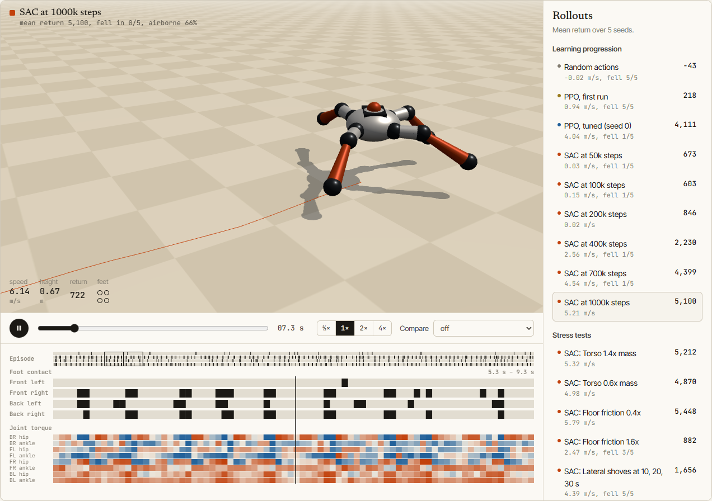
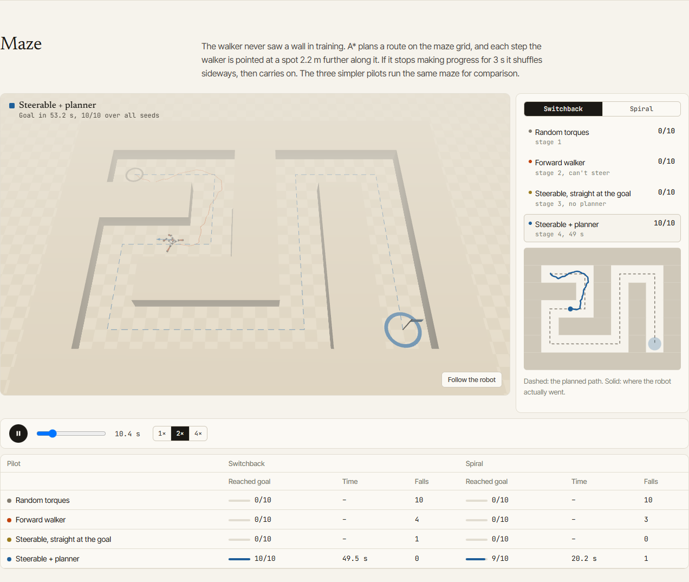
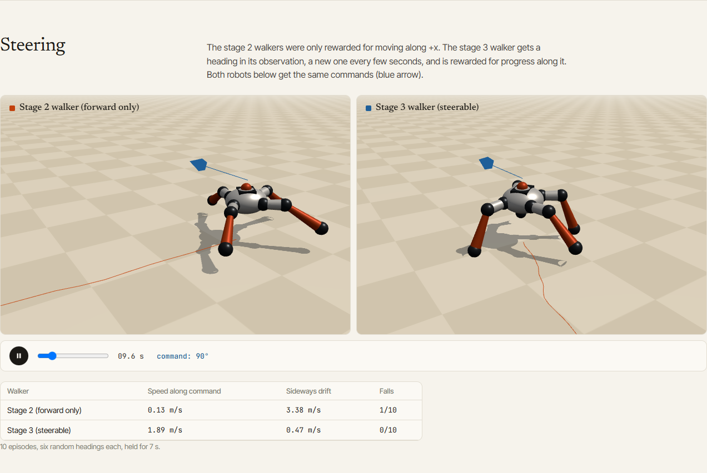
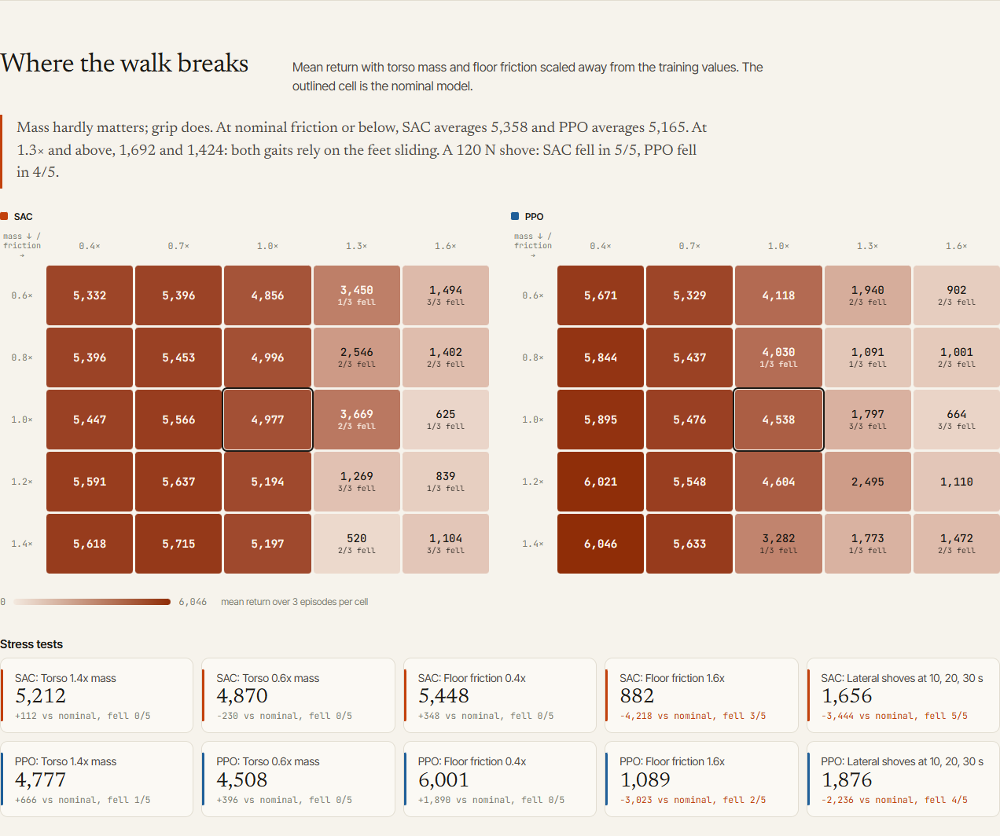

# Quadruped RL

The MuJoCo Ant trained in four stages: random torques, a forward walk (SAC and PPO), a walk that follows a commanded heading, and that walker driven through mazes by an A* planner. The site in `web/` replays recorded MuJoCo rollouts of every stage.



[GUIDE.md](GUIDE.md) explains the whole project in depth: the algorithms, why each design choice was made, and the questions to expect.

## Results

### Maze (stage 4)



Ten episodes per pilot and maze, seeds 100–109. The walker checkpoint was picked on seeds 0–5 (`maze_sweep.py`).

| Pilot | Switchback (88 m route) | Spiral (32 m route) |
| --- | --- | --- |
| Random torques | 0 / 10 | 0 / 10 |
| Forward walker (stage 2) | 0 / 10 | 0 / 10 |
| Steerable walker aimed at the goal | 0 / 10 | 0 / 10 |
| **Steerable walker + A\* planner** | **10 / 10**, 49 s | **9 / 10**, 20 s |

The forward walker can't turn, and aiming the steerable walker straight at the goal pins it against the first wall in the way. The planner follows an A* route, smoothed by line of sight with 1.3 m clearance, using pure pursuit with a 2.2 m lookahead. Some walker checkpoints occasionally freeze in a stance that still earns the survival bonus. When progress drops below 0.3 m in 3 s, the planner commands a short sideways shuffle.

### Steering (stage 3)



| Walker | Speed along command | Sideways drift | Falls |
| --- | --- | --- | --- |
| Stage 2 SAC (forward only) | 0.13 m/s | 3.38 m/s | 1 / 10 |
| **Stage 3 PPO (steerable)** | **1.89 m/s** | 0.47 m/s | 0 / 10 |

`nav_env.py` adds a heading command to the observation, changes it every 250–500 steps, and rewards progress along it. Penalties on sideways drift, bounce and tilt remove the bounding gait from stage 2. PPO, 8M steps, 42 min on CPU.

### Walking (stage 2)

| Policy | Return (5 seeds) | Speed | Falls |
| --- | --- | --- | --- |
| SAC, 1M steps | **5,100 ± 165** | 5.2 m/s | 0 / 5 |
| PPO, tuned, 2M steps | 4,111 ± 978 | 4.0 m/s | 1 / 5 |
| PPO, first run, 1M steps | 218 ± 188 | 0.9 m/s | 5 / 5 |
| Random torques | −43 | – | 5 / 5 |

The first PPO run started with an action std of 1.0, which throws the torso past the health limit within a few dozen steps. The tuned preset (log σ = −1, separate 256×256 networks, 8 × 1024-step rollouts) raised the return about 15× at the same step count.

SAC stands still for the survival bonus until somewhere between 200k and 400k steps, then learns a bounding gait (all feet off the ground 66% of the time). Mass changes barely matter, but at 1.3× friction or more returns fall to 1,400–1,700, because they rely on the feet sliding.



## Run

```bash
python -m venv .venv
.venv\Scripts\activate          # Windows; source .venv/bin/activate elsewhere
pip install -r requirements.txt

python train.py --algo sac --timesteps 1000000
python train.py --algo ppo --timesteps 2000000 --run-name ppo_tuned_s0
python export_web.py             # walking rollouts, stress tests, robustness grid

python train_nav.py --timesteps 8000000
python maze_sweep.py             # pick the walker checkpoint
python export_nav.py             # steering and maze rollouts

cd web
npm install
npm run dev                      # http://127.0.0.1:5175
```

`npm test` checks the exported data against what the viewer expects.

## Deploy

`render.yaml` is a Render Blueprint for a static site: **New → Blueprint**, pick the repo. Render builds `web/` and serves `web/dist`. Models and logs are not committed; only the exported rollouts (about 9 MB) ship with the site.

## Code

```text
train.py            Stage 2: SAC and PPO
nav_env.py          Stage 3: heading-commanded Ant and its reward
train_nav.py        Stage 3 training
maze_env.py         Stage 4: maze geometry, A*, smoothing, pursuit, recovery
maze_eval.py        All pilots in all mazes
maze_sweep.py       Walker checkpoint selection
export_web.py       Walking rollouts and robustness grid for the site
export_nav.py       Steering and maze rollouts for the site
web/                Site: three.js replay, gait diagram, charts
```

## Limits

One training seed per configuration. No actuator latency, sensor noise or rough terrain. The planner is given the maze layout; the walker never sees walls.
